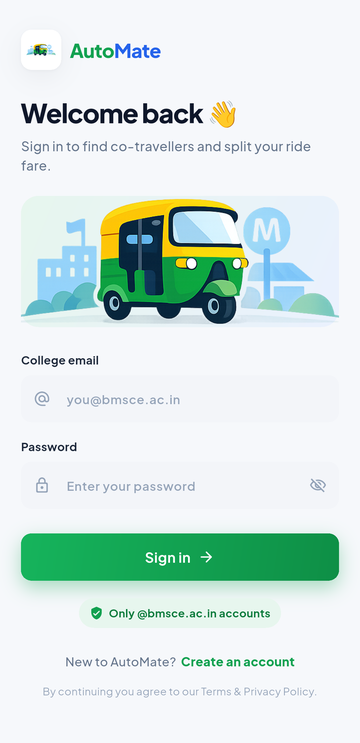
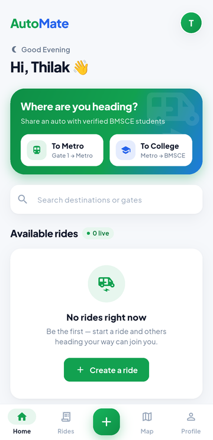
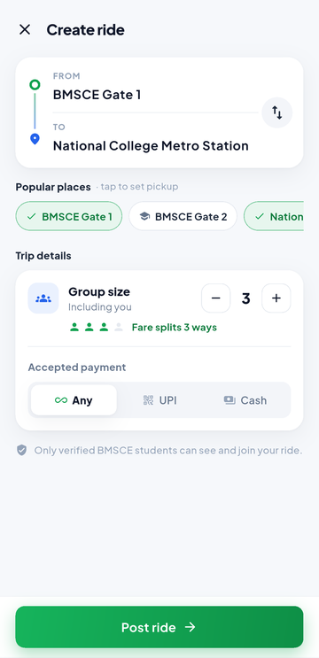
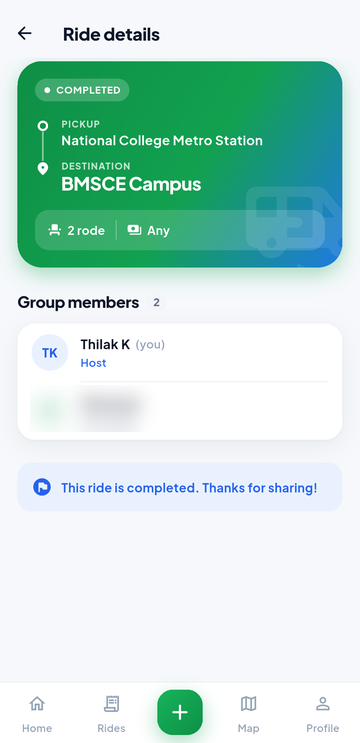
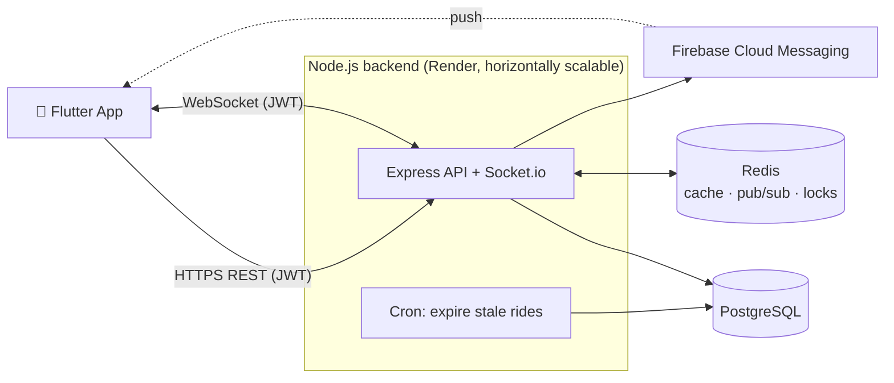

# 🛺 AutoMate

**Peer-to-peer ride sharing for BMSCE students.**

Students heading the same way — to the metro, college, station or airport — find each other, form a ride group, coordinate the pickup in a live chat, then book **one** auto or cab together and split the fare.

**[⬇️ Download the Android app (latest release)](https://github.com/Thilak-K2121/AutoMate/releases/latest)**

<p align="center">
  
  
  
  
</p>

---

## Features

- **Campus-only** — sign-up restricted to `@bmsce.ac.in` emails.
- **Ride groups** — create, discover, join and leave rides; live seat counts; one active ride per user.
- **Women-only rides** — visible to and joinable by female students only (enforced on the server).
- **Live group chat** — typing indicators, delivered / read ticks.
- **Notifications** — in-app, real-time, and push notifications when the app is closed.
- **Host controls** — complete, cancel, remove or block a passenger.
- **Auto-expiry** — abandoned rides are cancelled after 30 minutes and members are notified.

## Tech Stack

| Layer | Technology |
|---|---|
| Mobile app | Flutter (Dart), Material 3 |
| Backend | Node.js, Express |
| Real-time | Socket.io (WebSocket) |
| Database | PostgreSQL (Supabase) |
| Cache & coordination | Redis (Render Key Value) |
| Push notifications | Firebase Cloud Messaging |
| Hosting | Render (auto-deploy from `main`) |

## Architecture



**Engineering highlights**

- **No overbooking** — joining a ride runs in a transaction that locks the ride row (`SELECT … FOR UPDATE`), backed by a `UNIQUE(ride_id, user_id)` constraint.
- **Scale-ready** — the Socket.io Redis adapter delivers events across server instances, the read cache lives in Redis, and a Redis lock ensures the cron job runs once cluster-wide. No sticky sessions needed (WebSocket-only transport).
- **Secure real-time** — JWT verified on the socket handshake; chat is delivered only to ride members; user identity is taken from the token, never the client payload.
- **Fast mobile dashboard** — one Backend-for-Frontend endpoint returns everything the home screen needs; responses are gzipped and briefly cached.
- **Graceful degradation** — if Redis is unavailable the backend keeps running in single-instance mode.

## Data Model

| Table | Purpose |
|---|---|
| `users` | Student accounts (bcrypt passwords, gender for women-only rides) |
| `rides` | Ride groups — route, seats, status (`active` / `full` / `completed` / `cancelled`), payment mode |
| `ride_participants` | Who is in which ride (host included); kept as history |
| `messages` | Ride chat |
| `notifications` | In-app notifications |
| `blocked_passengers` | Users a host blocked from a ride |
| `user_devices` | Firebase push tokens |

Schema: [`database/init.sql`](database/init.sql)

## API

All endpoints except register, login and health require `Authorization: Bearer <JWT>`.

| Method | Endpoint | Description |
|---|---|---|
| POST | `/api/auth/register` | Create account |
| POST | `/api/auth/login` | Log in, returns JWT |
| GET | `/api/auth/me` | Current user |
| POST | `/api/auth/fcm-token` | Register device for push |
| POST | `/api/rides/create` | Create a ride |
| GET | `/api/rides/dashboard` | Home screen data (BFF) |
| GET | `/api/rides/nearby` | Live rides visible to the user |
| GET | `/api/rides/my-rides` | Hosted and joined rides |
| GET | `/api/rides/history` | Completed rides |
| GET | `/api/rides/stats` | Rides hosted / taken |
| GET | `/api/rides/:id` | Ride details and members |
| POST | `/api/rides/join` · `/leave` | Join or leave a ride |
| POST | `/api/rides/end` · `/cancel` | Host completes or cancels |
| POST | `/api/rides/:id/remove` · `/:id/block` | Host removes or blocks a passenger |
| GET | `/api/messages/:rideId` | Chat history (members only) |
| POST | `/api/messages/send` | Send a chat message |
| GET | `/api/notifications` | List notifications |
| PUT | `/api/notifications/read` | Mark all as read |
| GET | `/health` | Health check (incl. Redis status) |

## Project Structure

```
AutoMate/
├── backend/                 Node.js + Express API
│   ├── server.js            App entry: Redis → Socket.io → cron → listen
│   └── src/
│       ├── config/          PostgreSQL pool, Redis connection
│       ├── controllers/     auth, rides, messages, notifications
│       ├── routes/          REST routes
│       ├── services/        shared cache, push notifications
│       └── sockets/         Socket.io auth, rooms and events
├── frontend/flutter_app/    Flutter app
│   └── lib/
│       ├── screens/         app screens
│       ├── services/        API + push services
│       ├── theme/           design system
│       └── widgets/         shared UI components
├── database/init.sql        Database schema
└── docker-compose.yml       Local Postgres + Redis + backend
```

## Running Locally

**Prerequisites:** Node.js 18+, Flutter 3.x, Docker.

**Backend** — starts PostgreSQL, Redis and the API on `http://localhost:3000`:

```bash
git clone https://github.com/Thilak-K2121/AutoMate.git
cd AutoMate
docker compose up --build
```

To run the backend without Docker, create `backend/.env`:

```env
DATABASE_URL=postgres://...      # or DB_HOST / DB_USER / DB_PASSWORD / DB_NAME
JWT_SECRET=change-me
REDIS_URL=redis://localhost:6379 # optional — runs single-instance without it
FIREBASE_SERVICE_ACCOUNT={...}   # optional — enables push notifications
```

then `cd backend && npm install && npm run dev`.

**App:**

```bash
cd frontend/flutter_app
flutter pub get
flutter run
```

The API URL is set in `lib/services/api_service.dart` (`socketUrl`).

> Never commit `.env` files, `serviceAccountKey.json` or `google-services.json`.

## Documentation

- [Interview preparation guide (PDF)](AutoMate_Interview_Preparation.pdf) — design, architecture diagrams, database, decisions, full API
- [Redis & horizontal scaling guide](REDIS_HORIZONTAL_SCALING_GUIDE.md)
- [System design guide](SYSTEM_DESIGN_AND_ARCHITECTURE_GUIDE.md)
- [Engineering change log (Word)](AutoMate_Change_Log.docx)

## Roadmap

- Pickup-points map — rides shown as pins at their pickup locations
- In-app UPI fare splitting
- Live location sharing between group members before pickup
- Rate limiting and idempotency keys

---

<p align="center">Built for the BMSCE student community 🛺</p>
