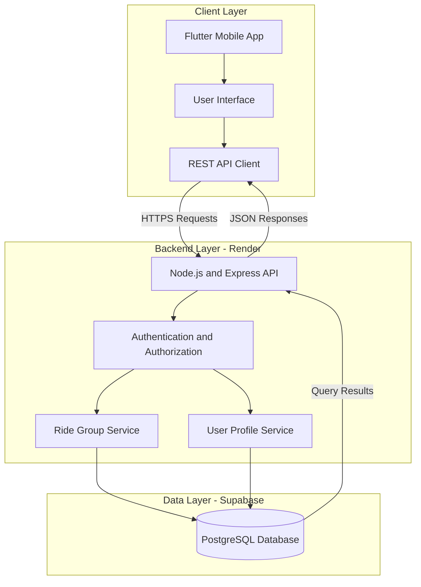
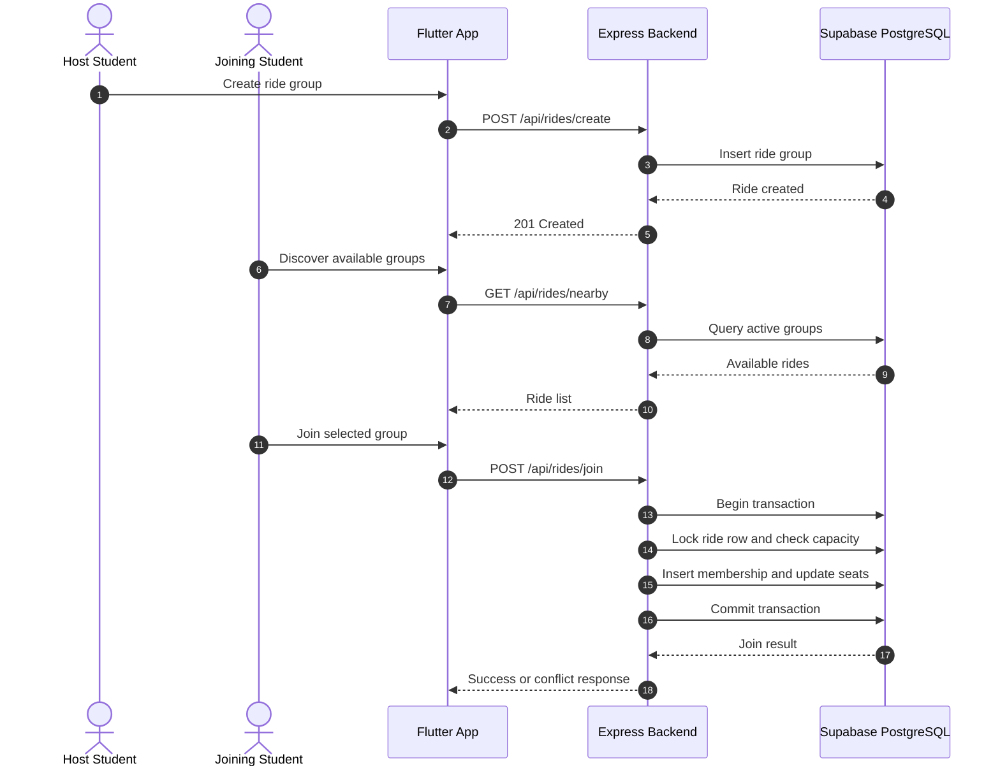
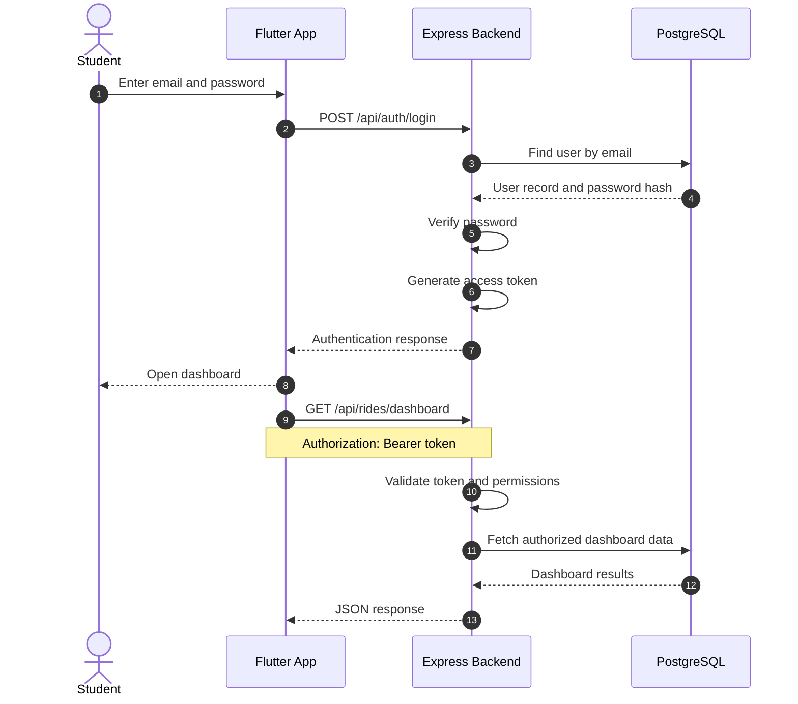
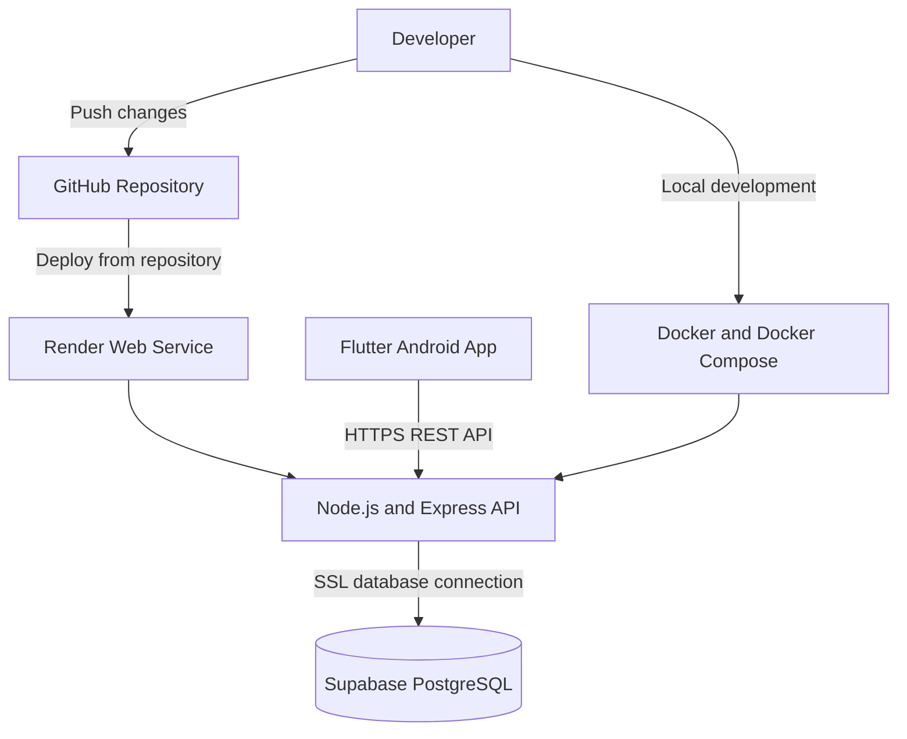

#  AutoMate

**An exclusive student travel coordination platform for the B.M.S. College of Engineering (BMSCE) community.**

AutoMate simplifies ride-sharing, ensuring secure and efficient transit to common destinations for students. By connecting campus peers, it reduces travel costs, optimizes commutes, and enhances safety through targeted coordination features.

---

##  Current Features

- **Campus-Exclusive Ride Sharing:** Dedicated network restricted to BMSCE students for finding and coordinating travel mates to common destinations.
- **Security-First Coordination:** Integrated gender-specific matching and verification features to prioritize rider safety.
- **Cross-Platform Mobile App:** High-performance frontend built with Flutter, delivering a fluid user experience.
- **Polished UI/UX Elements:** Custom-designed native splash screens and Android Adaptive Icons configured for modern devices.
- **Robust Backend API:** Powered by Node.js and Express, securely deployed and health-checked on Render.
- **Scalable Database Architecture:** Integrated with Supabase (PostgreSQL) utilizing optimized SSL connection pooling.
- **Containerized Environment:** Fully managed local development and deployment workflow using Docker and Docker Compose, optimized with build caching.

---

##  Tech Stack

### Frontend
- Flutter and Dart
- `flutter_native_splash`
- `flutter_launcher_icons`

### Backend and Database
- Node.js
- Express.js
- Supabase (PostgreSQL)

### DevOps and Deployment
- Docker
- Docker Compose
- Render

---

##  System Architecture & Design

AutoMate follows a client-server architecture. The Flutter application communicates with the Node.js and Express backend through REST APIs. PostgreSQL stores application data, while the architecture can support WebSockets and Firebase Cloud Messaging as real-time communication features are implemented.

### 1. High-Level Design (HLD)

This diagram illustrates how the mobile application, backend services, and database interact.



### 2. Ride Group Creation and Joining

This flow illustrates how students create ride groups and join available groups. The backend must validate seat availability before accepting a new member.




**Database integrity considerations:**

- Use foreign keys to maintain valid relationships between users, rides, and participants.
- Add a unique constraint on `(ride_id, user_id)` to prevent duplicate membership.
- Use database transactions and appropriate row locking to prevent seat overbooking.
- Validate ride status and seat capacity before accepting membership changes.
- Adapt the diagram to match the actual tables and columns in your migrations.

### 3. Authentication Flow

The backend validates credentials during login and protects private endpoints using authenticated requests.



**Security requirements:**

- Store password hashes, never plaintext passwords.
- Keep signing secrets and database credentials outside source control.
- Validate token expiration and signature.
- Enforce ride-level authorization on protected operations.
- Use HTTPS for production API traffic.

### 4. Deployment Architecture

This diagram represents the current hosting approach using Render, Supabase, and Docker-based local development.



The diagram shows the intended deployment relationship. Actual deployment triggers, container configuration, and network settings depend on the repository and hosting configuration.

---

##  Future Implementations (Roadmap)

The following features are planned for upcoming releases to further enhance the platform:

- **UPI Payment Integration:** Seamless in-app expense splitting and direct UPI payments between travel mates.
- **AI-Powered Insights:** Smart suggestions for optimal travel routes, times, and dynamic matchmaking using the Gemini API.
- **Real-Time Live Location Tracking:** In-app map integration to track incoming travel mates before pickup.
- **Real-Time Chat:** Live group messaging for coordinating pickup locations and departure times.
- **Push Notifications:** Alerts for group membership changes, ride updates, and relevant activity.
- **Ride History and Ratings:** Trip history, user feedback, and community trust features.

---

##  Installation & Local Setup

### Prerequisites

- [Flutter SDK](https://docs.flutter.dev/get-started/install) (v3.0.0+)
- [Node.js](https://nodejs.org/) (v18+)
- [Docker and Docker Compose](https://www.docker.com/)

### 1. Clone the Repository

```bash
git clone https://github.com/Thilak-K2121/AutoMate.git
cd AutoMate
```

### 2. Backend Setup

```bash
cd backend
npm install
```

Configure your `.env` file with the required environment variables for your backend and Supabase connection.

Start the local Docker environment using the command appropriate for your Compose installation:

```bash
docker compose up --build
```

If your project uses the legacy Compose executable, use `docker-compose up --build` instead.

**Important:** Never commit `.env` files containing credentials, passwords, or signing secrets to GitHub.

### 3. Frontend Setup

Open a terminal in the Flutter application directory:

```bash
cd ../frontend/flutter_app
flutter clean
flutter pub get
flutter run
```

Ensure that the backend API URL configured in the Flutter app is reachable from the device or emulator. Android emulators may require a different host address than a physical device.

---

##  Download the App

The latest stable Android release (`AutoMate.apk`) is available for download.

**[👉 Download AutoMate v1.0.0 / Latest Release](https://github.com/Thilak-K2121/AutoMate/releases/latest)**

*Note: You may need to authorize installation from the relevant source in your Android device settings before installing the APK.*

---


**Built for the BMSCE student community. 🛺**
