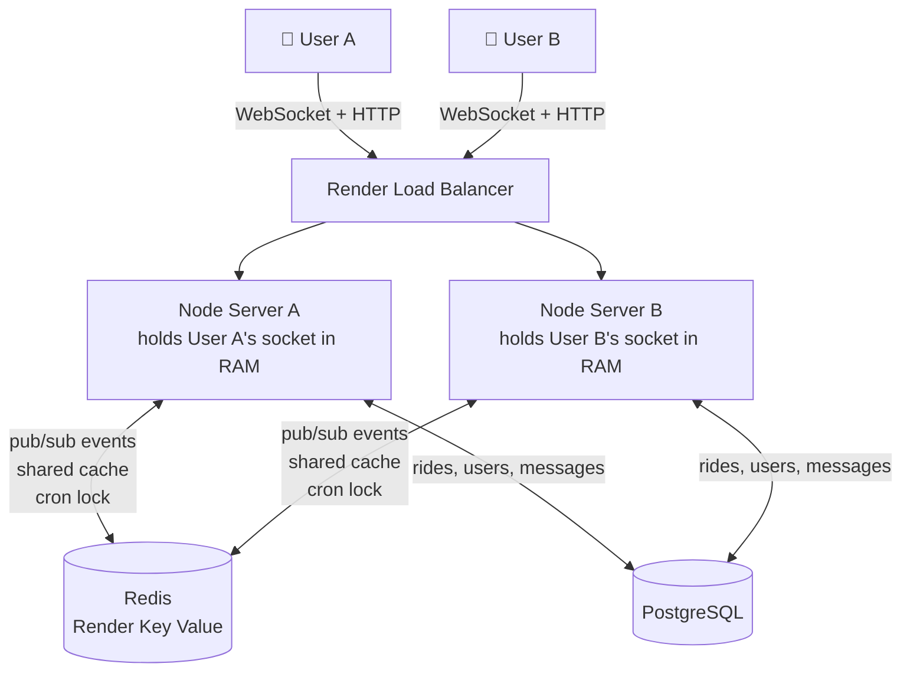
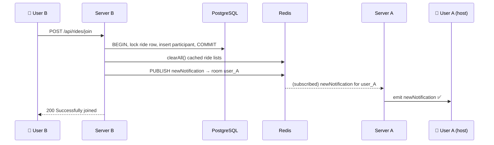

# AutoMate — Redis & Horizontal Scalability Guide

> **Status:** Scale-ready. Production runs **one** instance today; going to N instances only requires raising the instance count on Render — **no code changes**.

---

## 1. The Problem: a Stateful Backend

Before this change, the Node.js backend kept three kinds of state **inside its own process memory (RAM)**:

| State | Where it lived | What breaks with 2+ servers |
|---|---|---|
| **Socket.io rooms** (`user_<id>`, `ride_<id>`) | Socket.io's default in-memory adapter | User B (on Server B) joins User A's ride. Server B emits `newNotification` to `user_A` — but User A's socket lives on Server A. **Server B finds nobody; User A never gets the event.** Same for chat messages, typing, read ticks, `rideEnded`. |
| **Read cache** (dashboard / nearby rides) | A `Map` inside `rideController.js` | `cache.clearAll()` only clears the server it runs on. Other servers keep serving **stale ride lists** until their TTL expires. |
| **Cron job** (auto-cancel rides older than 30 min) | `node-cron` in every process | Runs on **every** instance every minute → duplicate updates and duplicate broadcasts. |

Each server was an island — unaware that other servers exist.

### What was *never* at risk: the data
Rides, users, participants, messages and notifications are written to **PostgreSQL**, a separate shared database. If a Node server crashes, **no ride is lost**. Only live connections are lost (and they reconnect automatically — see §5).

---

## 2. The Solution: Redis as the Shared Layer

Redis is a separate, shared in-memory server that **every backend instance connects to**. It gives the instances a common place to talk and to remember short-lived things.



Redis solves each problem:

| Problem | Redis feature | How |
|---|---|---|
| Events don't reach users on other servers | **Pub/Sub** via `@socket.io/redis-adapter` | Every `io.emit()` / `io.to(room).emit()` is also **published to Redis**. All instances are subscribed; the one holding the target socket delivers it. Controllers didn't change at all. |
| Cache inconsistent across servers | **Shared key-value cache** | Cache entries live in Redis (`automate:cache:*`) with a TTL. Invalidation on any server is seen by all servers instantly. |
| Cron runs N times | **Distributed lock** (`SET key value NX PX 55000`) | Every instance tries to set the lock each minute; Redis lets only the first succeed. That instance runs the job; others skip. The lock auto-expires, so a crashed holder never blocks the job. |

---

## 3. Where Things Live (RAM vs Redis vs Postgres)

| What | Where | Lost if a server crashes? |
|---|---|---|
| The live WebSocket connection | **Server RAM** (the one server the user connected to) | Yes — but the app reconnects automatically |
| Which rooms that socket joined | **Server RAM** | Yes — but the app re-joins on reconnect |
| Events travelling between servers | **Redis Pub/Sub** (relayed, not stored) | No |
| Cached ride lists (6–8s TTL) | **Redis** | No (and it's just a cache — it refills from Postgres) |
| Cron lock | **Redis** | No (expires automatically) |
| Rides, users, participants, messages, notifications | **PostgreSQL** | **No — permanent** |

> A WebSocket is a live connection to one specific process — it *cannot* be stored in Redis (like you can't store an ongoing phone call in a database). Redis makes servers able to **reach** each other's connections.

---

## 4. Request Flow: "User B joins User A's ride" (2 servers)



Without Redis, the arrow from Redis to Server A doesn't exist — User A would never be notified.

---

## 5. Failure Scenarios

### A Node server crashes
1. User A's socket (in Server A's RAM) disconnects.
2. Socket.io client in the Flutter app **auto-reconnects** — the load balancer routes it to a healthy server (B).
3. On `onConnect`, the app re-emits `joinUserRoom` / `joinRideRoom` (already implemented in `home_page.dart`, `chat_page.dart`, `metro_ride_details_page.dart`); chat re-fetches history.
4. The ride, passengers and messages are all still in Postgres → **user sees exactly the same state**.

### Redis goes down
- The server **does not crash**. `/health` reports `redis: "down"`.
- Cache reads/writes fall back to the in-memory `Map`; sockets keep working for users on the same instance.
- ioredis reconnects automatically when Redis returns.
- If Redis is unreachable **at boot** (or `REDIS_URL` is not set), the server starts in **single-instance mode** — identical to the pre-Redis behaviour. Redis is never a hard dependency.

### Why no sticky sessions are needed
Socket.io's HTTP long-polling transport needs sticky sessions (every poll request must hit the same server). The Flutter app uses **`transports: ['websocket']` only** — a single persistent connection — so any server can accept it, and the load balancer can route freely.

---

## 6. Implementation — Files Changed

| File | Change |
|---|---|
| `backend/src/config/redis.js` **(new)** | Connects to `REDIS_URL` with `ioredis`. Creates a command client (cache + locks) and a `pub`/`sub` pair (Socket.io adapter). Falls back to single-instance mode if Redis is missing/unreachable. Exposes `isReady()`, `status()`, `instanceId`. |
| `backend/src/services/cacheService.js` **(new)** | `get` / `set(ttl)` / `clearAll` backed by Redis (keys `automate:cache:*`, JSON + `PX` TTL), with in-memory fallback. `clearAll` uses non-blocking `SCAN` + `UNLINK`. |
| `backend/src/sockets/socketManager.js` | Attaches `@socket.io/redis-adapter` when Redis is ready. All event handlers unchanged. |
| `backend/server.js` | Async `start()`: Redis → Socket.io/adapter → cron → `listen`. Cron wrapped in a Redis lock; cron now also invalidates the cache. `/health` reports `redis` status + `instance`. Graceful shutdown on `SIGTERM` (Render deploys). |
| `backend/src/controllers/rideController.js` | In-memory `Map` cache replaced by `cacheService` (same keys & TTLs). In `endRide` / `cancelRide`, cache invalidation moved **before** the socket broadcast so clients that refetch never get stale data. |
| `backend/package.json` | Added `ioredis`, `@socket.io/redis-adapter`. |
| `docker-compose.yml` | Added `redis:7-alpine` service + `REDIS_URL` for local dev. |

**No Flutter changes** — event names, rooms and payloads are identical.

---

## 7. Production Setup (Render)

1. Render Dashboard → **New + → Key Value** → same region as the web service → Free plan.
2. Copy its **Internal Key Value URL** (`redis://red-xxxx:6379`).
3. Web service → **Environment** → add `REDIS_URL` = that URL.
4. Deploy. Logs should show:
   ```
   ✅ Redis connected (instance: ...)
   ✅ Socket.io Redis adapter enabled (multi-instance ready)
   Server is running on port ...
   ```
5. `GET /health` → `"redis": "up"`.

**To scale later:** Web service → Scaling → increase instance count (requires a paid instance type). Nothing else changes.

> ⚠️ Pool sizing when scaling: each instance opens up to 10 Postgres connections (`db.js`, `max: 10`). Keep `instances × 10` below the database's connection limit.

---

## 8. Verification Performed

Tested locally with two backend instances (ports 3911 / 3912) sharing one Redis:

| Test | Result |
|---|---|
| Boot without `REDIS_URL` | ✅ Single-instance mode; sockets + rooms work; `/health` → `redis: disabled` |
| Boot with unreachable Redis | ✅ Falls back to single-instance mode, no crash |
| User A on Server 1, User B on Server 2, same ride room; B emits `typing` + `markMessagesRead` | ✅ A received both events across servers |
| Process 1 sets cache, Process 2 reads it; `clearAll()` from Process 3 | ✅ Shared value read; cleared for everyone |
| Cron tick with 2 instances running | ✅ Only one instance ran the job; lock held by its instance id |
| Redis killed while server is running | ✅ Server stays up, `/health` → `redis: down`, sockets still connect |

---

## 9. Interview Talking Points

- **"Is your backend stateless?"** — The HTTP layer is stateless (JWT auth, all data in Postgres). Real-time state that must be in-process (socket connections) is coordinated through the **Redis adapter**, so any instance can serve any user.
- **"What happens if a server dies?"** — Only live connections drop; clients auto-reconnect to another instance and re-join their rooms. Data is in Postgres, so nothing is lost.
- **"How do you avoid duplicate background jobs?"** — Distributed lock with Redis `SET NX PX`; lock TTL < job interval so a crashed holder never blocks the next run.
- **"How do you keep caches consistent?"** — Shared Redis cache with short TTLs; writes invalidate before broadcasting so refetches always read fresh data.
- **"Why not sticky sessions?"** — WebSocket-only transport means one long-lived connection, so no per-request affinity is needed.
- **"What if Redis fails?"** — Graceful degradation to single-instance behaviour; Redis is an accelerator/coordinator, not the source of truth.

---

## 10. Future Work (not yet implemented)

- **Cloudflare** in front of Render (TLS, DDoS protection, WAF) — requires a custom domain.
- **Rate limiting** with a Redis store (`rate-limit-redis`) so limits are shared across instances.
- **Socket authentication** (verify JWT in the Socket.io handshake instead of trusting client-sent user IDs).
- **Move startup migrations** out of `db.js` into a one-off script, so N instances don't run DDL concurrently at boot.
- **Pagination** for chat messages and notifications.
