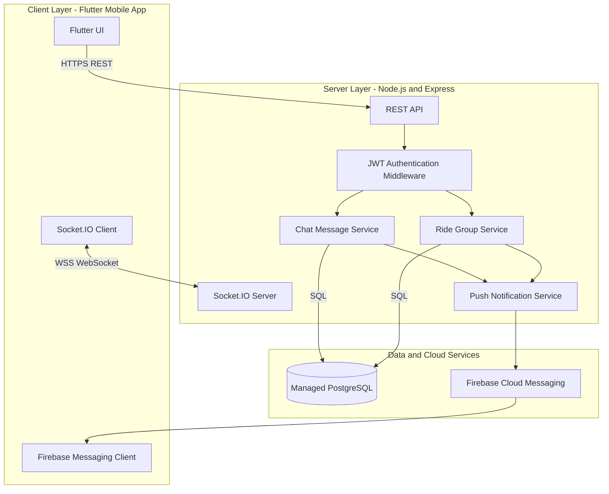
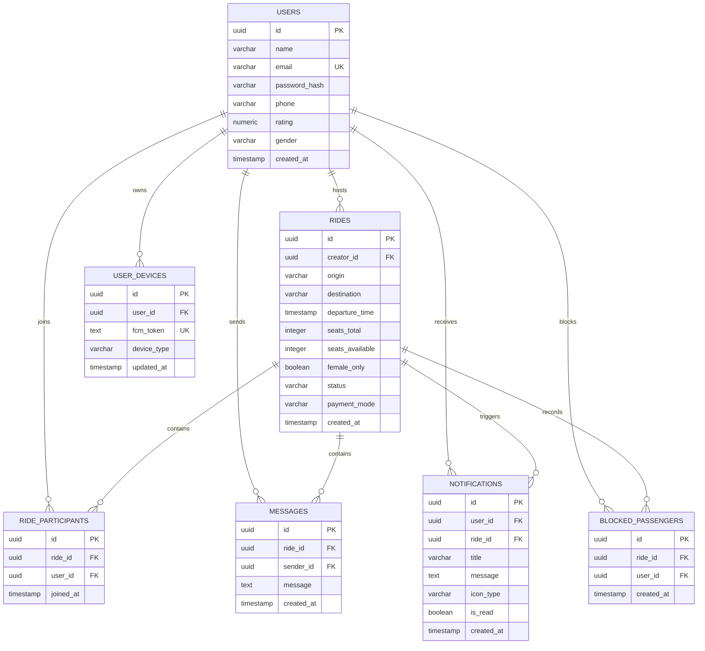
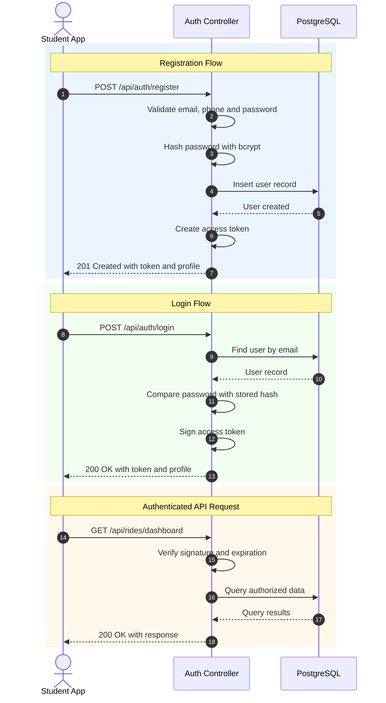
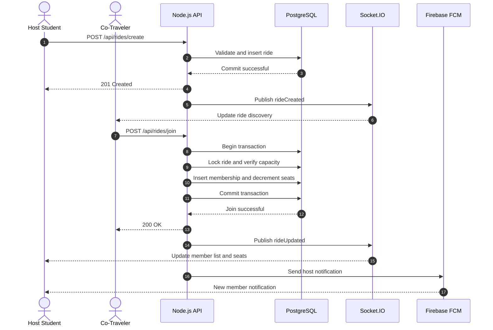
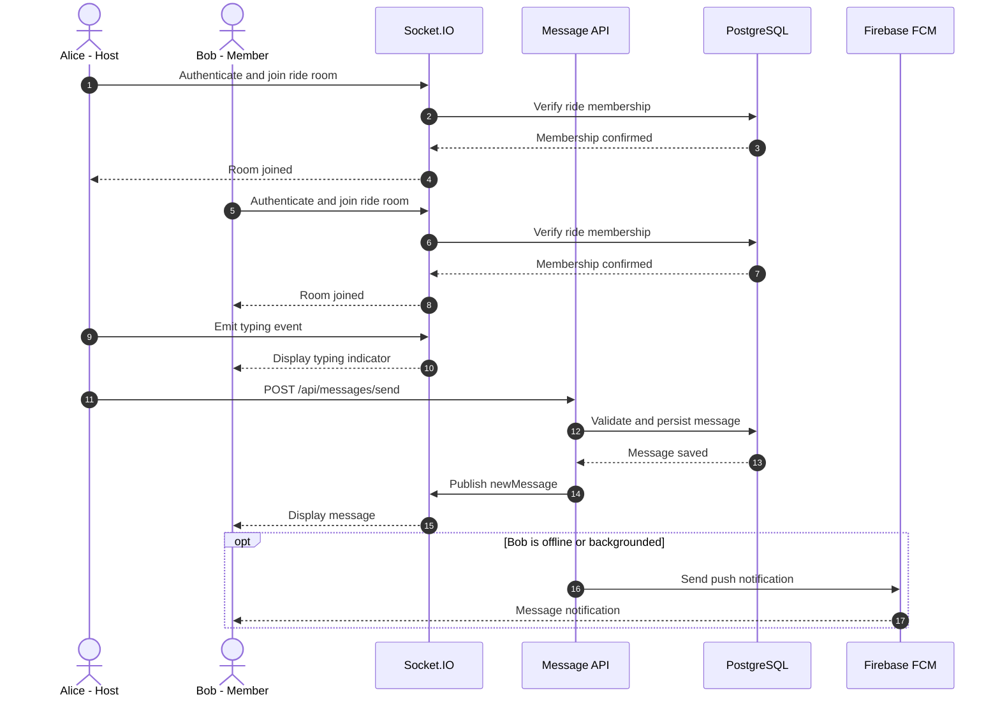
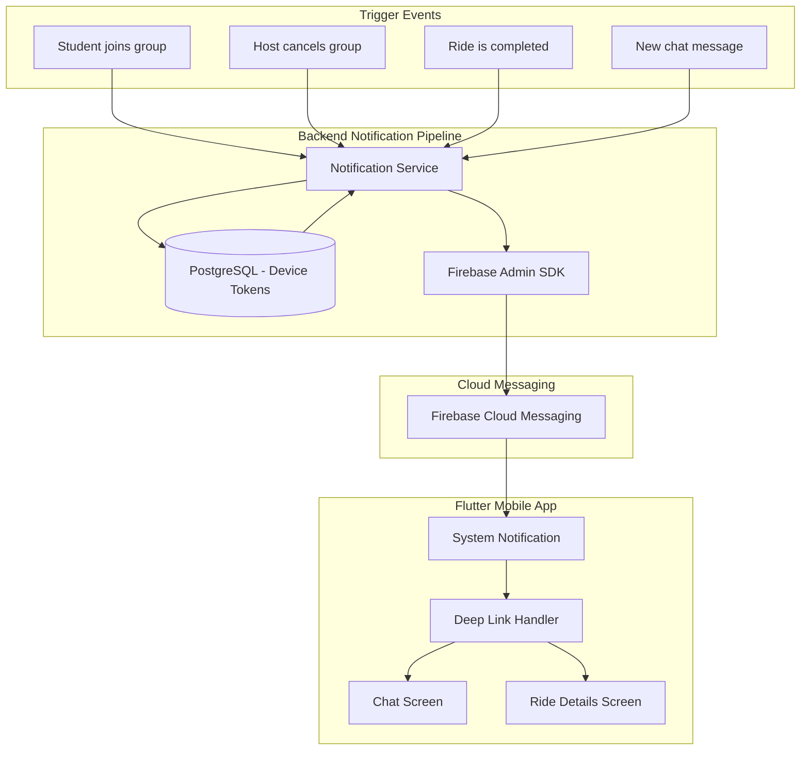

# 🚗 AutoMate — System Design & Architecture Guide

## Table of Contents

1. [The Real Problem & What AutoMate Is](#1-the-real-problem--what-automate-is)
2. [System Design: 4-Stage Breakdown](#2-system-design-4-stage-breakdown)
   - [Stage 1: Functional & Non-Functional Requirements](#stage-1-functional--non-functional-requirements)
   - [Stage 2: API Endpoints & Request/Response Contracts](#stage-2-api-endpoints--requestresponse-contracts)
   - [Stage 3: High-Level System Design (HLD)](#stage-3-high-level-system-design-hld)
   - [Stage 4: Detailed Low-Level Design (LLD & Scalability)](#stage-4-detailed-low-level-design-lld--scalability)
3. [Database Design & Entity Relationships](#3-database-design--entity-relationships)
4. [Authentication Flow & Security](#4-authentication-flow--security)
5. [End-to-End User Journeys](#5-end-to-end-user-journeys)
6. [Real-Time Push Notification Architecture](#6-real-time-push-notification-architecture)
7. [Interview Quick Summary & Pitch](#7-interview-quick-summary--pitch)

---

# 1. The Real Problem & What AutoMate Is

## 🛑 The Problem with Existing Ride-Sharing Apps

### 1. Students Travel Alone and Pay High Fares

Multiple students from the same college or hostel often travel to the same destination, such as a metro station, railway station, airport, or tech park. However, each student books a ride individually and pays the full fare.

### 2. Commercial Ride Pooling May Not Meet Students' Needs

- Passengers may have limited control over pickup points and route preferences.
- Per-passenger pricing may not reflect an equal split of the actual ride fare.
- Students need a simple way to find trusted co-travelers before booking a ride.

### 3. No Dedicated Campus Coordination

Students lack a dedicated platform to discover nearby people traveling in the same direction, coordinate pickup locations, and organize a shared ride.

---

## 💡 What Is AutoMate?

**AutoMate is a peer-to-peer co-traveler discovery and ride-splitting platform for students and daily commuters.**

Instead of drivers creating pooled rides, users organize their own groups.

1. **Create a group:** A student posts a trip, such as Campus Gate 2 to Central Metro Station at 5:00 PM.
2. **Discover and join:** Other students heading to the same destination find the group and reserve available places.
3. **Coordinate in real time:** Members use in-app chat to agree on the meeting point and departure time.
4. **Meet and book:** The group meets in person and books a single ride through Uber, Ola, Rapido, or a local auto-rickshaw.
5. **Split the fare:** Members divide the actual fare according to their agreed payment arrangement.

For example, a ₹150 ride shared equally by three students costs ₹50 per person.

---

# 2. System Design: 4-Stage Breakdown

## Stage 1: Functional & Non-Functional Requirements

### 🟢 A. Functional Requirements

1. **User Authentication:** Students register and log in using email, password, and phone number.
2. **Ride Group Creation:** A host specifies the origin, destination, departure time, seat capacity, payment preference, and optional female-only eligibility.
3. **Ride Discovery:** Students browse active groups and see current seat availability.
4. **Join and Leave:** Students join available groups or leave groups they have joined.
5. **Host Management:** Hosts cancel or complete groups and remove members. Users can block abusive users according to the platform's rules.
6. **Real-Time Chat:** Group members exchange messages and receive typing indicators and message-delivery status where supported.
7. **Push Notifications:** Users receive notifications for relevant events, including joins, departures, cancellations, and chat messages.
8. **Profiles and Statistics:** Users can view hosted rides, joined rides, completed trips, and ratings.
9. **Safety and Reporting:** Users can report inappropriate behavior and access group membership information before meeting.

### 🔵 B. Non-Functional Requirements

1. **Concurrency Safety:** Two users competing for the final seat must never both succeed.
2. **Low Latency:** Aim for sub-100 ms API responses for common indexed reads under defined load and deployment conditions.
3. **Real-Time Updates:** Aim for approximately 200 ms event propagation under normal network conditions.
4. **Data Integrity:** Database transactions maintain consistency between memberships, seat counts, and ride status.
5. **Cost Efficiency:** Start with free-tier or low-cost services where available, subject to current provider quotas and policies.
6. **Network Efficiency:** Use pagination, compact payloads, compression where beneficial, and appropriate socket lifecycle management.
7. **Security:** Protect user data, enforce authorization, and validate every state-changing request.
8. **Availability:** Recover gracefully from temporary database, network, or notification-provider failures.

> **Note on the $0 target:** Free tiers are suitable for prototypes, but they do not guarantee zero cost indefinitely. Hosting limits, sleeping services, database quotas, and provider pricing can change.

---

## Stage 2: API Endpoints & Request/Response Contracts

Protected endpoints require an access token:

`Authorization: Bearer <JWT_TOKEN>`

### API Endpoint Summary

| Module | Method and path | Description |
|---|---|---|
| Auth | `POST /api/auth/register` | Register a student |
| Auth | `POST /api/auth/login` | Authenticate and obtain a token |
| Auth | `GET /api/auth/me` | Get the current profile |
| Auth | `POST /api/auth/fcm-token` | Register or refresh a device token |
| Rides | `GET /api/rides/dashboard` | Load consolidated dashboard data |
| Rides | `POST /api/rides/create` | Create a co-travel group |
| Rides | `GET /api/rides/nearby` | Discover active groups |
| Rides | `GET /api/rides/:id` | Get group details |
| Rides | `POST /api/rides/join` | Join a group safely |
| Rides | `POST /api/rides/leave` | Leave a group |
| Rides | `POST /api/rides/cancel` | Cancel a hosted group |
| Rides | `POST /api/rides/end` | Complete a group |
| Rides | `POST /api/rides/:id/remove` | Remove a member |
| Rides | `POST /api/rides/:id/block` | Block a user from a group |
| Rides | `GET /api/rides/history` | Retrieve ride history |
| Messages | `GET /api/messages/:rideId` | Retrieve paginated chat history |
| Messages | `POST /api/messages/send` | Send a chat message |
| Notifications | `GET /api/notifications` | Retrieve notifications |
| Notifications | `PUT /api/notifications/read` | Mark notifications as read |

### 1. Create a Ride Group

**Endpoint:** `POST /api/rides/create`

Request:

```json
{
  "origin": "Campus Gate 2",
  "destination": "Central Metro Station",
  "departureTime": "2026-10-22T17:00:00+05:30",
  "seatsTotal": 3,
  "paymentMode": "UPI",
  "femaleOnly": false
}
```

Response — `201 Created`:

```json
{
  "message": "Ride group created successfully!",
  "ride": {
    "id": "9b1deb4d-3b7d-4bad-9bdd-2b0d7b3dcb6d",
    "creator_id": "2a4b1b53-ee0f-4199-bee6-f7ffbcc17d62",
    "origin": "Campus Gate 2",
    "destination": "Central Metro Station",
    "seats_total": 3,
    "seats_available": 3,
    "status": "active"
  }
}
```

The example timestamp and identifiers are illustrative. The backend should validate the departure time, capacity, and all other input fields.

### 2. Consolidated Dashboard

**Endpoint:** `GET /api/rides/dashboard`

Response — `200 OK`:

```json
{
  "user": {
    "id": "2a4b1b53-ee0f-4199-bee6-f7ffbcc17d62",
    "name": "Alex",
    "email": "alex@uni.edu"
  },
  "activeJoinedRide": {
    "id": "9b1deb4d-3b7d-4bad-9bdd-2b0d7b3dcb6d",
    "destination": "Central Metro Station",
    "meeting_point": "Campus Gate 2",
    "seats_available": 1,
    "seats_total": 3,
    "status": "active"
  },
  "availableRides": [
    {
      "id": "e4d2b6c7-9f01-4f0d-9d55-8e1a2b3c4d5e",
      "creator_name": "Sarah",
      "destination": "Tech Park",
      "meeting_point": "Library Circle",
      "seats_available": 2,
      "seats_total": 3,
      "payment_mode": "UPI",
      "female_only": false
    }
  ],
  "unreadNotifications": true
}
```

The Backend-for-Frontend (BFF) endpoint consolidates dashboard data into one client request. The server may still execute multiple database queries internally.

### 3. Join a Ride Group

**Endpoint:** `POST /api/rides/join`

Request:

```json
{
  "rideId": "9b1deb4d-3b7d-4bad-9bdd-2b0d7b3dcb6d"
}
```

Response — `200 OK`:

```json
{
  "message": "Successfully joined the co-travel group!",
  "seatsRemaining": 1
}
```

Possible errors:

| Status | Meaning |
|---|---|
| `400` | Invalid request or group is full |
| `401` | Missing or invalid authentication |
| `403` | User is not eligible to join |
| `404` | Ride group not found |
| `409` | Already joined or conflicting state |

Use consistent error response formats across all endpoints.

---

## Stage 3: High-Level System Design (HLD)

The architecture uses a three-tier client-server model.



### Architecture Components

- **Flutter:** Mobile interface, navigation, local state, and notification handling.
- **Express REST API:** Handles authentication, ride operations, profiles, and notifications.
- **JWT middleware:** Verifies access tokens and establishes the authenticated user identity.
- **Ride service:** Enforces membership, capacity, eligibility, and ride lifecycle rules.
- **Chat service:** Persists messages and validates group membership.
- **Socket.IO:** Sends real-time events to authorized clients.
- **PostgreSQL:** Stores durable application data and enforces relational integrity.
- **Firebase Cloud Messaging (FCM):** Delivers push notifications to supported mobile devices.

The REST API and WebSocket server can initially run in one Node.js service. They can be separated later if traffic or deployment requirements justify it.

---

## Stage 4: Detailed Low-Level Design (LLD & Scalability)

### Reliability and Performance Patterns

| Pattern | Purpose |
|---|---|
| Atomic SQL updates and row locking | Prevent seat overbooking |
| BFF aggregation | Reduce client-side network round trips |
| Set-based SQL | Avoid N+1 query patterns |
| Connection pooling | Reuse database connections efficiently |
| Compression | Reduce payload size when beneficial |
| Authorized socket rooms | Isolate group chat and event delivery |
| Database indexes | Accelerate common lookup patterns |
| Transactional outbox | Prevent lost events after database commits |
| Rate limiting | Reduce abuse and excessive request volume |

### 1. Concurrency Safety: Preventing Seat Overbooking

Suppose two students try to reserve the last available seat simultaneously. The database must serialize the competing operations.

A safe implementation uses a transaction and locks the ride row before checking capacity.

```sql
BEGIN;

SELECT id, seats_available, status
FROM rides
WHERE id = $1
FOR UPDATE;

-- Application must verify:
-- 1. The ride exists and is joinable.
-- 2. The ride has an available seat.
-- 3. The user is not already a participant.
-- 4. The user satisfies group eligibility rules.

INSERT INTO ride_participants (ride_id, user_id)
VALUES ($1, $2);

UPDATE rides
SET seats_available = seats_available - 1,
    status = CASE
        WHEN seats_available - 1 = 0 THEN 'full'
        ELSE 'active'
    END
WHERE id = $1;

COMMIT;
```

If any validation or write fails, the application must roll back the transaction.

**Important implementation details:**

- The host's membership must be represented consistently with the seat-counting rules.
- Add a unique constraint on `(ride_id, user_id)` to prevent duplicate memberships.
- Locking must happen before checking availability.
- Every join, leave, removal, and cancellation path must follow consistent transaction rules.
- Use idempotency keys where appropriate to handle retried requests safely.

The row lock ensures that a second transaction waits until the first transaction commits or rolls back. It then sees the latest committed seat count.

### 2. Eliminating N+1 Database Query Loops

**Problem:** Executing a separate database query for each participant or ride increases network round trips and query overhead.

**Solution:** Use set-based SQL for bulk operations, with transactional updates and appropriate locking.

For example, cancelling a group should restore or release seats only for participants whose memberships are actually removed. It should not increment seat counts indiscriminately.

A safer pattern for leaving one group is:

```sql
BEGIN;

SELECT id, seats_available, seats_total, status
FROM rides
WHERE id = $1
FOR UPDATE;

DELETE FROM ride_participants
WHERE ride_id = $1
  AND user_id = $2
RETURNING ride_id;

-- If a membership was deleted, update the seat count
-- only when the ride lifecycle permits leaving.

UPDATE rides
SET seats_available = LEAST(seats_available + 1, seats_total),
    status = 'active'
WHERE id = $1
  AND status = 'full'
  AND seats_available < seats_total;

COMMIT;
```

This is a simplified example. Production code must also handle the `active` state, cancelled or completed rides, host membership, and whether the deleted participant actually occupied a counted seat.

For bulk operations, select the affected rides, lock them in a consistent order, update their seat counts, and delete the relevant memberships within the same transaction. Avoid a bulk delete that removes memberships without reconciling seat counts.

### 3. Connection Pooling

Use a bounded PostgreSQL connection pool.

Example configuration:

```javascript
const pool = new Pool({
  connectionString: process.env.DATABASE_URL,
  max: 10,
  idleTimeoutMillis: 30000,
  connectionTimeoutMillis: 5000
});
```

These are starting values, not universal production settings. Tune the pool according to deployment concurrency, PostgreSQL connection limits, query duration, and the number of application instances.

Always release checked-out clients and avoid opening a new database connection for each request.

### 4. Room-Isolated WebSocket Events

Each ride group has a private socket room, such as:

`ride:<rideId>`

Clients must not be allowed to join arbitrary rooms without authorization. The server should validate the user's current membership before admitting them and before processing sensitive events.

Recommended event names:

| Event | Purpose |
|---|---|
| `rideCreated` | A new group is available |
| `rideUpdated` | Seats or group details changed |
| `rideCancelled` | A group was cancelled |
| `memberJoined` | A new member joined |
| `memberLeft` | A member left |
| `newMessage` | A chat message was persisted |
| `typing` | A member is typing |
| `notificationCreated` | A new notification is available |

Do not treat socket events as the source of truth. Persist important state changes in PostgreSQL and use events to notify clients that their views should be updated.

---

# 3. Database Design & Entity Relationships

AutoMate uses PostgreSQL as its primary relational database.

The following Mermaid diagram shows the main entities and their relationships.



## Entity Descriptions

- **USERS:** Account identity, contact details, password hash, and profile information.
- **RIDES:** Origin, destination, departure time, capacity, payment preference, and lifecycle state.
- **RIDE_PARTICIPANTS:** Membership of users in ride groups.
- **MESSAGES:** Persisted group chat messages.
- **NOTIFICATIONS:** Durable in-app notification records.
- **BLOCKED_PASSENGERS:** Group-level blocking records.
- **USER_DEVICES:** Device registration tokens used for push notifications.

### Important Database Constraints

```sql
ALTER TABLE users
ADD CONSTRAINT users_email_unique UNIQUE (email);

ALTER TABLE ride_participants
ADD CONSTRAINT ride_participants_unique
UNIQUE (ride_id, user_id);

ALTER TABLE rides
ADD CONSTRAINT rides_seat_capacity_check
CHECK (
    seats_total >= 0
    AND seats_available >= 0
    AND seats_available <= seats_total
);
```

Apply these constraints through versioned migrations, taking care not to recreate constraints that already exist.

For a production schema, also consider:

- Foreign keys for all referenced users and rides.
- `CHECK` constraints for valid ride statuses.
- A unique constraint for device tokens.
- A suitable unique constraint on `(ride_id, user_id)` in the block table.
- Explicit policies for historical records and account deletion.
- A defined strategy for keeping seat counts consistent with membership records.

### High-Performance Database Indexes

```sql
CREATE INDEX idx_rides_status_departure
ON rides (status, departure_time);

CREATE INDEX idx_rides_creator_id
ON rides (creator_id);

CREATE INDEX idx_ride_participants_ride_id
ON ride_participants (ride_id);

CREATE INDEX idx_ride_participants_user_id
ON ride_participants (user_id);

CREATE INDEX idx_messages_ride_created
ON messages (ride_id, created_at ASC);

CREATE INDEX idx_user_devices_user_id
ON user_devices (user_id);

CREATE INDEX idx_notifications_user_unread
ON notifications (user_id, created_at DESC)
WHERE is_read = FALSE;
```

Choose indexes based on actual query patterns and validate them using `EXPLAIN ANALYZE`. Indexes consume storage and increase write overhead, so avoid adding indexes without a reason.

---

# 4. Authentication Flow & Security

AutoMate uses JSON Web Tokens (JWT) for API authentication and bcrypt or another appropriate password-hashing algorithm for password storage.



## Security Best Practices

1. Never store plaintext passwords. Store only password hashes.
2. Keep JWT signing secrets and database credentials in environment variables or a secrets manager.
3. Validate access-token signatures, expiration, and expected claims.
4. Use short-lived access tokens and a secure refresh-token strategy where appropriate.
5. Enforce object-level authorization on every ride, chat, and notification endpoint.
6. Use parameterized SQL queries to prevent SQL injection.
7. Apply request validation, rate limits, and sensible payload-size limits.
8. Use HTTPS in production and WSS for WebSocket connections.
9. Do not expose FCM service-account credentials in the mobile application.
10. Protect private group membership and female-only eligibility rules.
11. Provide reporting and blocking features with clear moderation policies.
12. Never rely on a client-supplied user ID to determine the authenticated identity.

A seven-day access-token lifetime is possible, but a shorter lifetime may be preferable. Select the token lifetime and revocation strategy according to the application's security requirements.

---

# 5. End-to-End User Journeys

## A. Student Creates a Group and Co-Travelers Join



In production, events should be published only after the associated database transaction commits. A transactional outbox is a useful way to ensure that committed changes are eventually published even when a process crashes.

## B. Real-Time Chat and Meeting Coordination



Chat messages should be saved before the server broadcasts them. Typing indicators can be transient and do not normally need database persistence.

The backend should avoid sending duplicate push notifications to users who are actively viewing the same chat, where practical.

## C. Meeting in Person and Booking on External Platforms

1. Students meet at the agreed pickup landmark.
2. One member books a ride through Uber, Ola, Rapido, or a local auto-rickshaw.
3. The group agrees on the total fare and how it will be split.
4. Members settle their individual shares through their agreed payment method.
5. The host marks the AutoMate group as completed.
6. The completed group appears in ride history.

AutoMate coordinates the group; it does not automatically book an external ride or process payments unless those integrations are explicitly implemented.

---

# 6. Real-Time Push Notification Architecture

AutoMate uses Firebase Cloud Messaging (FCM) to deliver notifications to supported mobile devices.



## Notification Pipeline

1. A business event occurs, such as a member joining a group.
2. The backend commits the relevant database changes.
3. The notification service identifies eligible recipients and their registered device tokens.
4. The server uses the Firebase Admin SDK to send the notification.
5. FCM routes the notification to the appropriate device.
6. When a user taps the notification, the app opens the relevant ride or chat screen.

### Important Reliability Considerations

- Save in-app notifications in PostgreSQL so users can retrieve them later.
- Use the FCM device-token registration endpoint to refresh tokens.
- Remove or deactivate invalid tokens when FCM reports that they are no longer registered.
- Handle notification failures without rolling back an otherwise successful ride transaction.
- Use a transactional outbox or retryable job mechanism to avoid losing notifications when the backend crashes after a commit.
- Keep notification payloads small and avoid including sensitive information.
- Configure Android notification channels and the required platform permissions.
- Use deep links that verify authentication and authorization before showing private content.

**Cost note:** FCM offers a no-cost messaging option, but the total cost of AutoMate also depends on hosting, database usage, logging, networking, and other services. Free-tier quotas and terms can change, so the entire system cannot be guaranteed to remain at $0 per month.

---

# 7. Interview Quick Summary & Pitch

> **"AutoMate is a peer-to-peer co-traveler discovery and ride-splitting platform for students and commuters.**
>
> Instead of paying individual fares, students traveling in the same direction can create a group, discover co-travelers, coordinate pickup locations through real-time chat, and book one shared ride through an external ride-hailing service or local auto-rickshaw.
>
> The application uses Flutter for the mobile client, Node.js and Express for the backend, PostgreSQL for persistent data, Socket.IO for real-time communication, and Firebase Cloud Messaging for push notifications.
>
> The key system-design challenge is preventing seat overbooking. I address it through transactional database operations and row-level locking, combined with unique membership constraints. The architecture also uses a consolidated dashboard endpoint, indexed queries, connection pooling, authorized WebSocket rooms, and reliable notification delivery patterns.
>
> AutoMate focuses on affordability, convenience, and safer coordination for campus communities while keeping the initial architecture simple enough to deploy and scale incrementally." 

---

## Final GitHub Rendering Checklist

Before pushing your README, verify the following:

- Use `#`, `##`, and `###` directly for Markdown headings; do not prefix them with backslashes.
- Use triple backticks with the exact `mermaid` language identifier for every Mermaid diagram.
- Close every fenced code block with three backticks.
- Use plain Markdown tables and correctly formatted JSON and SQL blocks.
- Keep Mermaid node IDs simple, unique, and free of spaces.
- Quote complex labels and use `<br/>` only when needed for line breaks within Mermaid labels.
- Avoid HTML entities such as `&#x20;` in normal Markdown text.
- Preview the file in GitHub after committing the changes.

**Recommended filename:** `README.md`

With these changes, GitHub should render the headings, code examples, and Mermaid diagrams correctly, provided the repository's Markdown rendering is functioning normally.
